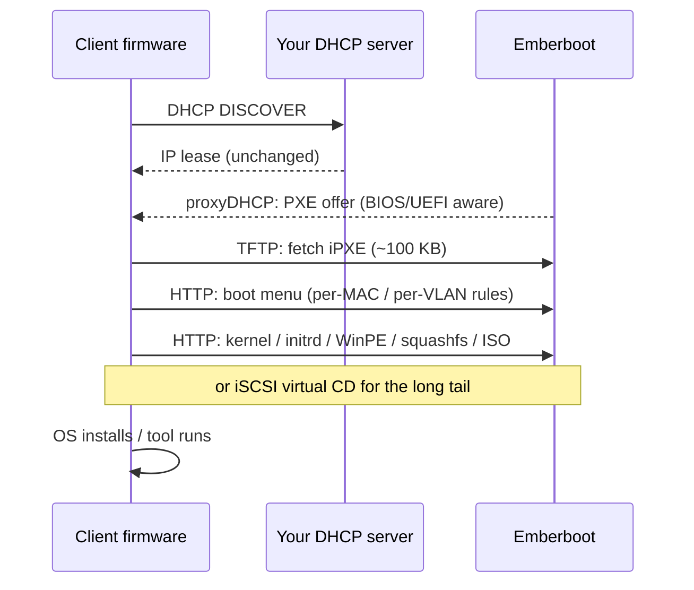
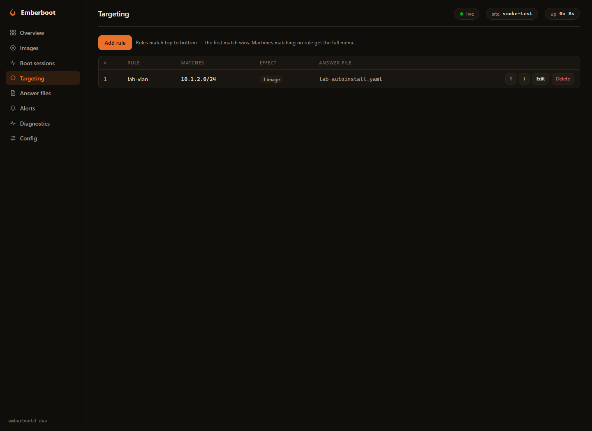
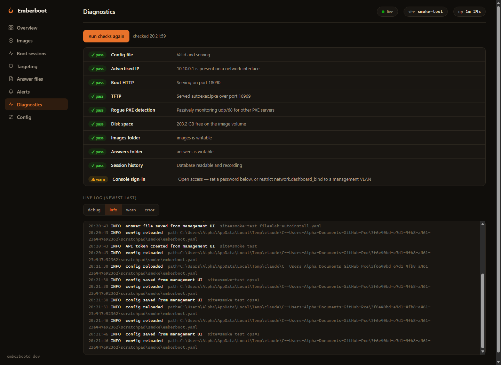

# 🔥 Emberboot

**A PXE boot server designed for unattended 24×7 operation on large multi-VLAN networks.**
Drop an ISO into a folder and Emberboot detects a boot plan, exposes its compatibility status, and serves it with an observable PXE workflow.

[](https://github.com/patnawa/Emberboot-PXE/releases)
[](LICENSE)
[](go.mod)
[](#deployment)


---

## Why Emberboot

| | |
|---|---|
| **Drop-in ISO boot** | Publish a completed ISO into a folder. Its structure is validated, its boot mechanism is detected, and it appears on the permitted client menus. Files are streamed **directly out of the ISO** — nothing is extracted to disk. |
| **Zero DHCP changes** | proxyDHCP by default: coexists with your existing DHCP server without touching it. Options-66/67 mode covers relayed multi-VLAN networks. |
| **Built for 24×7** | Crash-only design: one supervised process, all state in a hot-reloading YAML file with **last-known-good semantics** — a broken 2 a.m. edit never stops clients booting. Rebuild a dead server by restoring two folders. |
| **Scales to labs** | TFTP serves only the ~100 KB iPXE bootloader; every payload rides HTTP with range requests. Designed for hundreds of concurrent boots; each release must still pass a production-equivalent capacity test. |
| **See everything** | Per-client **Boot Session timelines** (DHCP → TFTP → menu → payload), an hourly activity chart, Prometheus metrics, structured logs, and webhook alerts — including **rogue PXE server detection**. |
| **No dark magic** | No closed-source kernel drivers, no leaked-key Secure Boot tricks, no opaque databases. When an ISO can't netboot, the console says so — and says why. |

## Quick start

**Windows** — double-click **`Start-Emberboot.bat`**. It elevates, adds the firewall rule, starts the server, and opens the console. First run creates a working config and an `images` folder; drop ISOs in.

**Linux**

```bash
# First run creates emberboot.yaml and ./images automatically.
# Needs CAP_NET_BIND_SERVICE and, for interface pinning, CAP_NET_RAW.
sudo ./emberbootd
```

The first-run console listens only at `http://127.0.0.1:8443`. To administer
it remotely, set a management-VLAN `dashboard_bind`, a TLS certificate/key,
and an admin password; exposed plaintext, anonymous, or token-only browser
management is rejected. API tokens are adjunct credentials for automation,
not a substitute for the browser sign-in. Then publish ISOs into `images/`
and PXE-boot a test Client.

**Container (Linux)** — persist all of `/data`, make it writable by UID/GID
65532, use host networking for DHCP broadcasts, and grant only the two network
capabilities Emberboot needs:

```bash
docker build --build-arg VERSION=v0.6.0 -f deploy/Dockerfile -t emberboot:v0.6.0 .
sudo install -d -o 65532 -g 65532 -m 0700 /srv/emberboot
docker run --name emberboot --restart unless-stopped --network host --read-only \
  --security-opt no-new-privileges \
  --cap-drop ALL --cap-add NET_BIND_SERVICE --cap-add NET_RAW \
  -v /srv/emberboot:/data emberboot:v0.6.0
```

Use the actual immutable release identifier for `VERSION`; it is reported by
`emberbootd -version` and placed in the image metadata. The bind-mounted state
contains config, Images, answers, the boot-grant signing key, and session data,
so it must survive container replacement. Do not put Docker secrets or an ISO
library in the build context; the root `.dockerignore` admits only build inputs.

## How a boot works



Every step lands in the client's Boot Session timeline; failures show a likely cause keyed to the stage where they died. A green **Payload handed off** result means Emberboot delivered the decisive payload or attached virtual media—it does not claim that the operating system subsequently booted or installed successfully.

## OS support

Boot mechanisms are detected per ISO from its actual contents:

- **Windows 10 / 11 / Server** — wimboot with SMB-free injected setup; `install.wim`/`.esd` over HTTP, unattended via `autounattend.xml`. An **iSCSI virtual-CD mode** is available as a proven low-RAM alternative.
- **Ubuntu & derivatives** (casper), **Debian-live family** (Clonezilla, GParted, Kali), **Fedora/RHEL live** (dracut), **Anaconda installers** (Fedora, RHEL, Rocky, Alma), **openSUSE/SLES**, **Arch/SystemRescue** (archiso), **Alpine** — kernel/initrd extracted server-side, payloads over HTTP, answer files (kickstart / autoinstall / AutoYaST / preseed) attachable per image or per targeting rule.
- **The long tail** (Debian installer ISOs, BSDs, appliances, DOS-era tools) — served as a **virtual CD by the embedded pure-Go iSCSI target**; standalone EFI tools (memtest86+ style) are chained directly on UEFI. The legacy `memdisk` strategy name means an iPXE HTTP SAN virtual CD backed by HTTP Range reads; it does **not** copy the whole ISO into RAM.
- RAM-loading family strategies display their estimated requirement. The stock embedded iPXE build does not expose `MEMMAP_SETTINGS`, so Emberboot cannot reliably measure Client RAM and does not automatically refuse an undersized Client; qualify RAM on the hardware matrix.

Full details, per-family requirements, and honest limitations: **[docs/COMPATIBILITY.md](docs/COMPATIBILITY.md)**.

**Firmware**: legacy BIOS and UEFI x64 are auto-detected per client, and native
UEFI HTTP Boot is implemented. Secure Boot is not yet wired into the DHCP boot
path; disable it on Emberboot Clients until the embedded shim chain is
explicitly integrated and qualified.

## Management console

A full management surface embedded in the binary — no external assets, works on an offline network. Per-image settings, targeting rules (per-VLAN/per-MAC menus, unattended installs, deny lists), an answer-file editor, alert history, sign-in and API tokens. **Every edit the UI makes goes through `emberboot.yaml` itself** — validated, atomic, hot-reloaded — so hand edits, git diffs, and disaster-recovery rebuilds always keep working.



The **Diagnostics** view runs real self-checks — a live TFTP read probe, boot-HTTP loopback, iSCSI listener, advertise-IP presence, disk and folder checks — and streams the server log:



## Configuration

One YAML file is the entire source of truth:

```yaml
site: bkk-hq
network:
  dhcp_mode: proxy              # or options66-67 for relayed VLANs
  dashboard_bind: "127.0.0.1:8443"
images:
  dir: images
  attach:
    Win11_24H2_English_x64.iso:
      answer_file: autounattend.xml
overrides:
  - name: lab-vlan
    subnet: 10.1.2.0/24
    menu: [clonezilla-live.iso]
```

It hot-reloads on save; invalid edits are rejected with line-level errors while the last good configuration keeps serving. Listener, admission-limit, Image/answer directory, and session-store changes are validated immediately but take effect after restart; `/healthz` and Diagnostics list the pending fields. Every option is documented in [`emberboot.example.yaml`](emberboot.example.yaml).

For large media, copy to a non-`.iso` temporary name, verify the publisher's
digest, then atomically rename it to `.iso`. Emberboot's Ready state validates
quiescence and ISO structure and records a full SHA-256, but it cannot assert
publisher authenticity unless the operator compares that value to a trusted
publisher digest.

## Security model

- The management listener is local-only on first run. Remote binds require a
  valid TLS certificate/key and an admin password for browser sign-in. API
  tokens are adjunct automation credentials stored only as one-way verifiers.
- Boot payload HTTP remains plaintext for firmware and installer compatibility,
  but image and answer-file URLs are short-lived signed grants bound to the
  requesting client IP, selected image, current targeting rule, and assigned
  answer file. Guessing a file URL does not bypass the menu policy.
- MAC rules use the MAC/IP association Emberboot observed during PXE DHCP; URL
  query parameters are not trusted identity. In deployments where Emberboot
  cannot observe DHCP, use subnet rules and network ACLs as the authority.
- The embedded iSCSI target has no CHAP. It is deny-all until client CIDRs are
  explicitly configured and must also be restricted by the host firewall.

## Observability & automation

- `GET /metrics` — Prometheus (DHCP/TFTP/HTTP counters, sessions, images, alerts)
- REST API with bearer tokens — health, images, sessions, activity, alerts, diagnostics, config (read *and* validated write)
- Webhook alerts: crash restart, invalid image, boot-failure spike, low disk, rejected config, **rogue PXE server on the wire**
- Structured JSON logs on stdout; live log ring in the console

## Deployment

- **Linux (recommended for production)**: [`deploy/emberboot.service`](deploy/emberboot.service) — supervised operation with only `CAP_NET_BIND_SERVICE` and `CAP_NET_RAW`, an 8,192-file-descriptor ceiling, a hardened sandbox, and UI-editable state under `/var/lib/emberboot`.
- **Windows**: `Start-Emberboot.bat` for interactive use; wrap with NSSM/WinSW for service duty.
- **Container**: the distroless image runs explicitly as UID/GID 65532; persist `/data`, use host networking, drop all capabilities, then add only `NET_BIND_SERVICE` and `NET_RAW` as shown above.
- **Ports**: UDP 67/69/4011 (DHCP/TFTP/PXE), TCP 8090 (boot HTTP), TCP 3260 (iSCSI — allowlisted boot VLANs only), TCP 8443 (HTTPS console on the management VLAN; loopback HTTP is allowed for local setup).

The defaults admit 600 simultaneous boot-HTTP streams and 768 iSCSI
connections, with an eight-connection/stream per-IP limit for each transport.
Those are safety ceilings, not throughput promises; tune them only alongside
`LimitNOFILE`, storage/network capacity, and a production-equivalent boot-storm
test. The architectural target remains 300 Concurrent Boots per Site.

Before serving production Clients, complete the
**[production hardening and release checklist](docs/PRODUCTION_CHECKLIST.md)**.

## Building from source

```bash
go build ./cmd/emberbootd     # single static binary, CGO-free
go test ./...
```

Go 1.25.13 or newer is required. The patch floor includes standard-library
security fixes enforced by the vulnerability scan.

Cross-compile with `GOOS=linux|windows GOARCH=amd64`. The embedded third-party boot binaries (iPXE v2.0.0, wimboot v2.9.0 — GPLv2) are pinned with SHA-256 provenance in [`internal/bootfiles/PROVENANCE.md`](internal/bootfiles/PROVENANCE.md).

## Design

The architecture is documented where it was decided:

- [`CONTEXT.md`](CONTEXT.md) — the domain glossary and settled scope
- [`docs/adr/`](docs/adr) — decision records: iPXE chainload transport, config-as-files with last-known-good, tiered boot strategies vs. driver magic, UI writes through the config file

## License

[MIT](LICENSE) © 2026 patnawa. Embedded iPXE and wimboot binaries are GPLv2; see [`internal/bootfiles/PROVENANCE.md`](internal/bootfiles/PROVENANCE.md) for sources and corresponding-source links.
