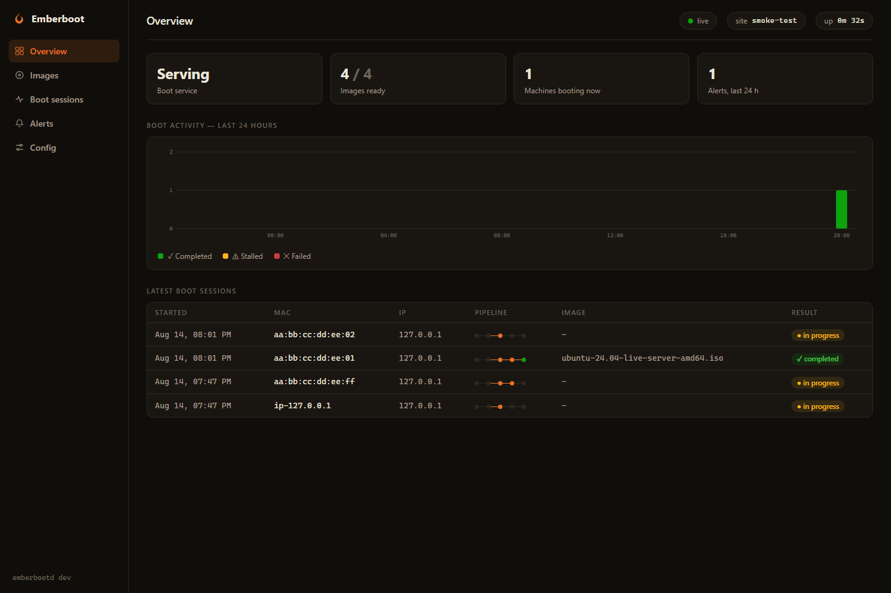
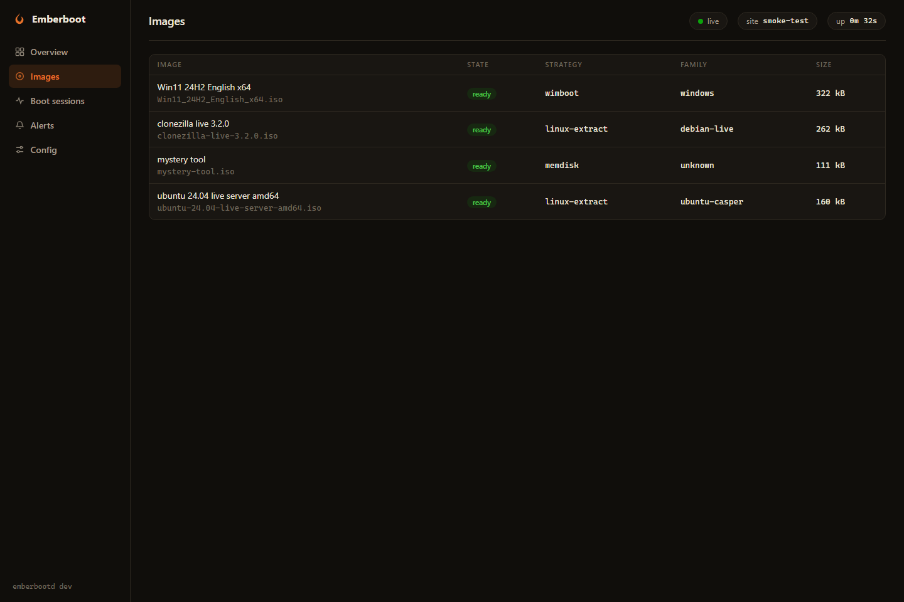

# Emberboot

A PXE boot server built for unattended 24x7 operation on large multi-VLAN
networks. Drop an ISO into a folder and it boots — with the reliability and
observability that iVentoy-class tools lack.



The embedded management console (no external assets, works on an offline
network): live Boot Session pipelines, hourly boot activity, image states
with their chosen Boot Strategy and the reason for it, alert history, and a
config view that shows the exact DHCP option 66/67 values for your network.



- **One static binary** (Go, CGO-free), Linux and Windows, container-friendly.
- **proxyDHCP** by default: coexists with your existing DHCP server, zero
  changes to it. Options-66/67 mode for relayed multi-VLAN networks.
- **iPXE chainload transport**: TFTP serves only the ~100KB iPXE bootloader;
  everything else rides HTTP with range requests — survives hundreds of
  concurrent boots. Native UEFI HTTP Boot supported where firmware allows.
- **Tiered Boot Strategies** per ISO, chosen automatically at validation:
  - *LinuxExtract* — Ubuntu (casper), Debian-live (Clonezilla/GParted),
    archiso (Arch/SystemRescue), Anaconda (Fedora/RHEL/Rocky/Alma),
    openSUSE/SLES: kernel/initrd extracted server-side, payload over HTTP.
  - *Wimboot* — Windows 10/11/Server installers, SMB-free: WinPE via wimboot
    with injected winpeshl.ini/setup script and HTTP-delivered sources.
  - *Memdisk* — anything else, whole-ISO-into-RAM via iPXE sanboot.
  - Files are served **directly out of the ISO** (streamed, zero extraction
    to disk).
- **Crash-only reliability**: config file + image folder are the entire
  source of truth; YAML hot-reloads with last-known-good semantics (a broken
  edit never stops clients booting); an ISO is only offered once fully
  copied and validated; SQLite session history is a disposable cache.
- **Observability**: JSON logs, Prometheus `/metrics`, per-client Boot
  Session timelines in a web dashboard, and webhook alerts for: crash
  restarts, invalid images, boot-failure spikes, low disk, rejected config,
  and **rogue PXE servers** heard on the wire.

## Quick start

**Windows — double-click `Start-Emberboot.bat`.** It asks for administrator
access (UDP 67/69), adds the firewall rule, starts the server, and opens the
management console. There is no setup: the first run creates a working
`emberboot.yaml` and an `images` folder next to the script — drop ISOs in
and they appear on the boot menu once validated.

**Linux / manual:**

```
# First run creates emberboot.yaml and ./images automatically.
# Needs UDP 67/69 privileges: root, CAP_NET_BIND_SERVICE, or admin.
./emberbootd
```

Tune the config afterwards (see emberboot.example.yaml for every option) —
it hot-reloads, so no restart is needed.

Open the dashboard at the configured `dashboard_bind` address. Generate the
admin password hash with `emberbootd hash-password`.

### Network posture

- `dhcp_mode: proxy` (default): nothing to change on your DHCP server.
- `dhcp_mode: options66-67`: set option 66 to Emberboot's IP and option 67 to
  `undionly.kpxe` (BIOS) / `snponly.efi` (UEFI) on your DHCP server; stock
  iPXE then fetches `autoexec.ipxe` from Emberboot's TFTP and chains to HTTP
  automatically. This mode works across DHCP relay / IP helpers.

### Secure Boot

Handled honestly: either disable Secure Boot on clients, or enroll the iPXE
project's shim chain (`shimx64.efi` + `snponly-sb.efi`, both embedded and
served over TFTP) per your firmware's certificate enrollment procedure. No
leaked-key tricks.

## Building

```
go build ./cmd/emberbootd
go test ./...
```

Third-party boot binaries (iPXE v2.0.0, wimboot v2.9.0) are embedded; exact
provenance and hashes in `internal/bootfiles/PROVENANCE.md`.

## Deployment

- Linux/systemd: `deploy/emberboot.service` (restart-always supervision —
  part of the crash-only design).
- Container: `deploy/Dockerfile` (host networking required for DHCP).
- Windows: run as a service via `sc.exe create` with a service wrapper such
  as NSSM/WinSW, or Task Scheduler at boot.

## Design documents

- `CONTEXT.md` — the domain glossary and settled scope.
- `docs/adr/` — architecture decision records (iPXE chainload transport,
  config-as-files with last-known-good, tiered strategies vs. driver magic).
