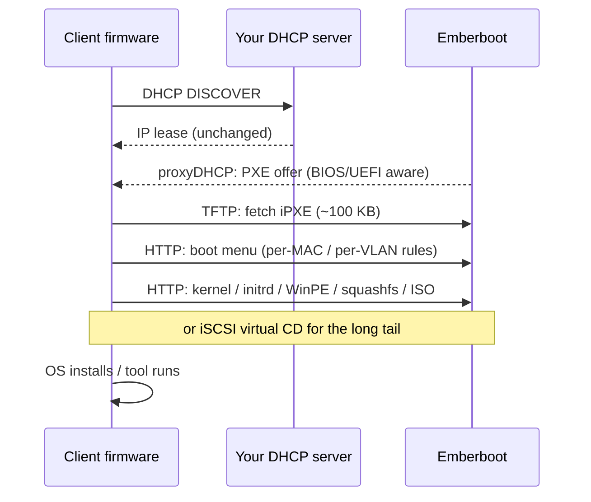

# 🔥 Emberboot

**A PXE boot server built for unattended 24×7 operation on large multi-VLAN networks.**
Drop an ISO into a folder and it boots — with the reliability, observability, and honest engineering that iVentoy-class tools lack.

[](https://github.com/patnawa/Emberboot-PXE/releases)
[](LICENSE)
[](go.mod)
[](#deployment)


---

## Why Emberboot

| | |
|---|---|
| **Drop-in ISO boot** | Copy an ISO into a folder. It is validated, its boot mechanism is detected, and it appears on every client's boot menu. Files are streamed **directly out of the ISO** — nothing is extracted to disk. |
| **Zero DHCP changes** | proxyDHCP by default: coexists with your existing DHCP server without touching it. Options-66/67 mode covers relayed multi-VLAN networks. |
| **Built for 24×7** | Crash-only design: one supervised process, all state in a hot-reloading YAML file with **last-known-good semantics** — a broken 2 a.m. edit never stops clients booting. Rebuild a dead server by restoring two folders. |
| **Scales to labs** | TFTP serves only the ~100 KB iPXE bootloader; every payload rides HTTP with range requests. Designed for hundreds of concurrent boots. |
| **See everything** | Per-client **Boot Session timelines** (DHCP → TFTP → menu → payload), an hourly activity chart, Prometheus metrics, structured logs, and webhook alerts — including **rogue PXE server detection**. |
| **No dark magic** | No closed-source kernel drivers, no leaked-key Secure Boot tricks, no opaque databases. When an ISO can't netboot, the console says so — and says why. |

## Quick start

**Windows** — double-click **`Start-Emberboot.bat`**. It elevates, adds the firewall rule, starts the server, and opens the console. First run creates a working config and an `images` folder; drop ISOs in.

**Linux**

```bash
# First run creates emberboot.yaml and ./images automatically.
# Needs UDP 67/69 privileges: root or CAP_NET_BIND_SERVICE.
sudo ./emberbootd
```

Then open the management console at `http://<server>:8443`, drop ISOs into `images/`, and PXE-boot any machine on the LAN. Set an admin password from **Config → Sign-in** as your first action.

**Container** — see [`deploy/Dockerfile`](deploy/Dockerfile) (requires `--network host` for DHCP visibility).

## How a boot works



Every step lands in the client's Boot Session timeline; failures show a likely cause keyed to the stage where they died.

## OS support

Boot mechanisms are detected per ISO from its actual contents:

- **Windows 10 / 11 / Server** — wimboot with SMB-free injected setup; `install.wim`/`.esd` over HTTP, unattended via `autounattend.xml`. An **iSCSI virtual-CD mode** is available as a proven low-RAM alternative.
- **Ubuntu & derivatives** (casper), **Debian-live family** (Clonezilla, GParted, Kali), **Fedora/RHEL live** (dracut), **Anaconda installers** (Fedora, RHEL, Rocky, Alma), **openSUSE/SLES**, **Arch/SystemRescue** (archiso), **Alpine** — kernel/initrd extracted server-side, payloads over HTTP, answer files (kickstart / autoinstall / AutoYaST / preseed) attachable per image or per targeting rule.
- **The long tail** (Debian installer ISOs, BSDs, appliances, DOS-era tools) — served as a **virtual CD by the embedded pure-Go iSCSI target**; standalone EFI tools (memtest86+ style) are chained directly on UEFI; whole-ISO-into-RAM remains the scripted last resort.
- Clients with too little RAM for a RAM-loading image get a clear on-screen refusal, not a mid-transfer failure.

Full details, per-family requirements, and honest limitations: **[docs/COMPATIBILITY.md](docs/COMPATIBILITY.md)**.

**Firmware**: legacy BIOS and UEFI x64 auto-detected per client; native UEFI HTTP Boot supported; Secure Boot handled honestly (embedded shim pair for enrollment — no signature tricks).

## Management console

A full management surface embedded in the binary — no external assets, works on an offline network. Per-image settings, targeting rules (per-VLAN/per-MAC menus, unattended installs, deny lists), an answer-file editor, alert history, sign-in and API tokens. **Every edit the UI makes goes through `emberboot.yaml` itself** — validated, atomic, hot-reloaded — so hand edits, git diffs, and disaster-recovery rebuilds always keep working.


The **Diagnostics** view runs real self-checks — a live TFTP read probe, boot-HTTP loopback, iSCSI listener, advertise-IP presence, disk and folder checks — and streams the server log:


## Configuration

One YAML file is the entire source of truth:

```yaml
site: bkk-hq
network:
  dhcp_mode: proxy              # or options66-67 for relayed VLANs
  dashboard_bind: "0.0.0.0:8443"
images:
  dir: images
  attach:
    Win11_24H2_English_x64.iso:
      answer_file: autounattend.xml
overrides:
  - name: lab-vlan
    subnet: 10.1.2.0/24
    menu: [clonezilla-live.iso]
```

It hot-reloads on save; invalid edits are rejected with line-level errors while the last good configuration keeps serving. Every option is documented in [`emberboot.example.yaml`](emberboot.example.yaml).

## Observability & automation

- `GET /metrics` — Prometheus (DHCP/TFTP/HTTP counters, sessions, images, alerts)
- REST API with bearer tokens — health, images, sessions, activity, alerts, diagnostics, config (read *and* validated write)
- Webhook alerts: crash restart, invalid image, boot-failure spike, low disk, rejected config, **rogue PXE server on the wire**
- Structured JSON logs on stdout; live log ring in the console

## Deployment

- **Linux (recommended for production)**: [`deploy/emberboot.service`](deploy/emberboot.service) — restart-always supervision with `CAP_NET_BIND_SERVICE`, hardened sandboxing.
- **Windows**: `Start-Emberboot.bat` for interactive use; wrap with NSSM/WinSW for service duty.
- **Ports**: UDP 67/69/4011 (DHCP/TFTP/PXE), TCP 8090 (boot HTTP), TCP 3260 (iSCSI), TCP 8443 (console — bind it to a management VLAN).

## Building from source

```bash
go build ./cmd/emberbootd     # single static binary, CGO-free
go test ./...
```

Cross-compile with `GOOS=linux|windows GOARCH=amd64`. The embedded third-party boot binaries (iPXE v2.0.0, wimboot v2.9.0 — GPLv2) are pinned with SHA-256 provenance in [`internal/bootfiles/PROVENANCE.md`](internal/bootfiles/PROVENANCE.md).

## Design

The architecture is documented where it was decided:

- [`CONTEXT.md`](CONTEXT.md) — the domain glossary and settled scope
- [`docs/adr/`](docs/adr) — decision records: iPXE chainload transport, config-as-files with last-known-good, tiered boot strategies vs. driver magic, UI writes through the config file

## License

[MIT](LICENSE) © 2026 patnawa. Embedded iPXE and wimboot binaries are GPLv2; see [`internal/bootfiles/PROVENANCE.md`](internal/bootfiles/PROVENANCE.md) for sources and corresponding-source links.
